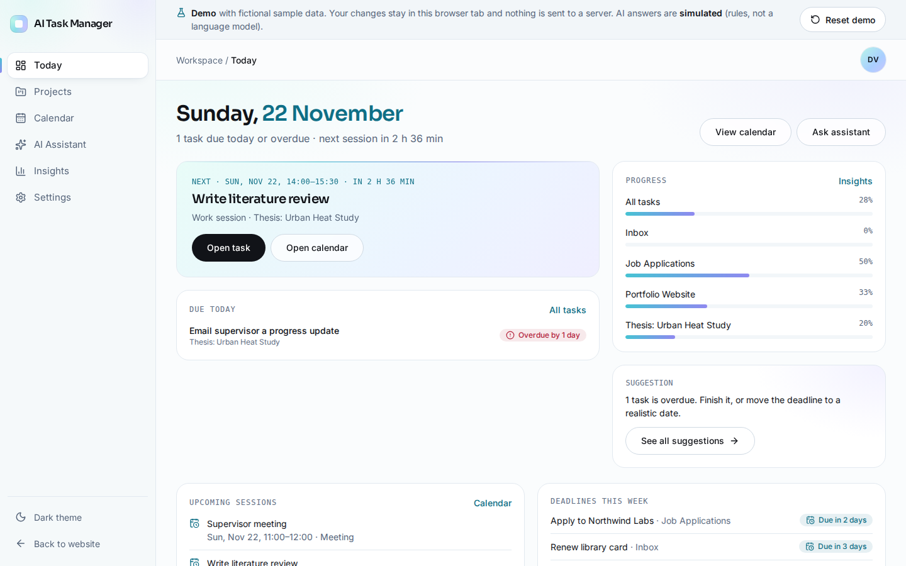
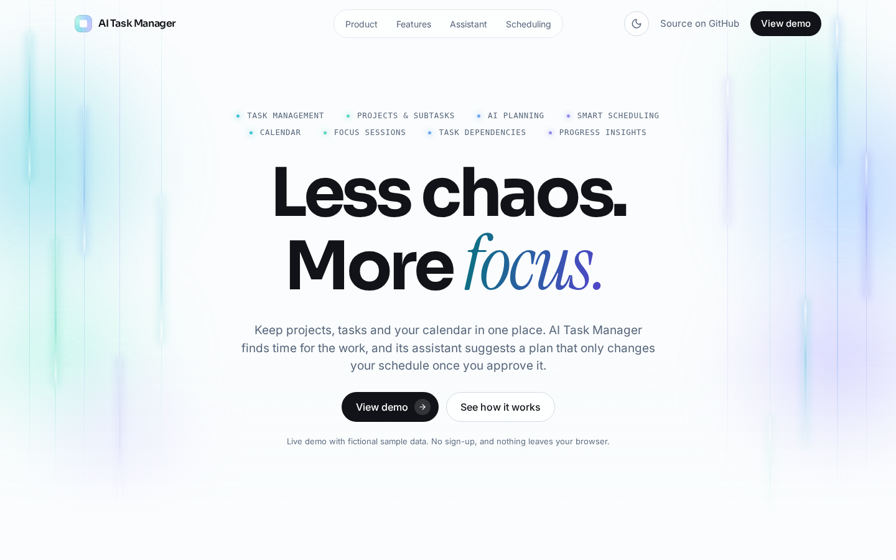
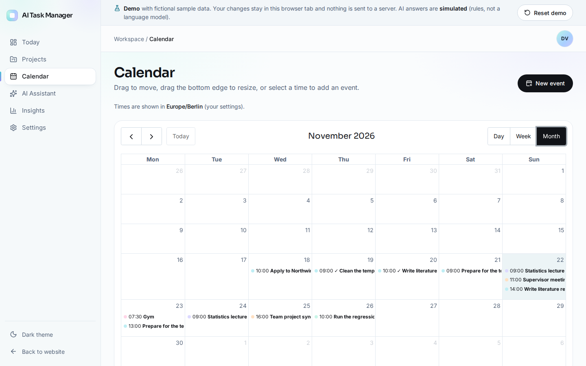
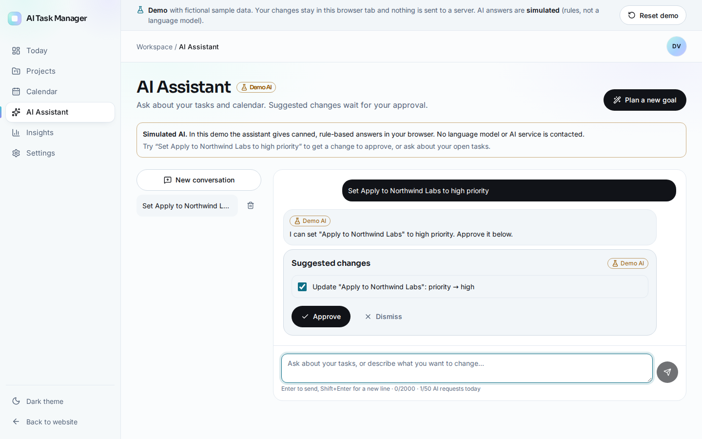
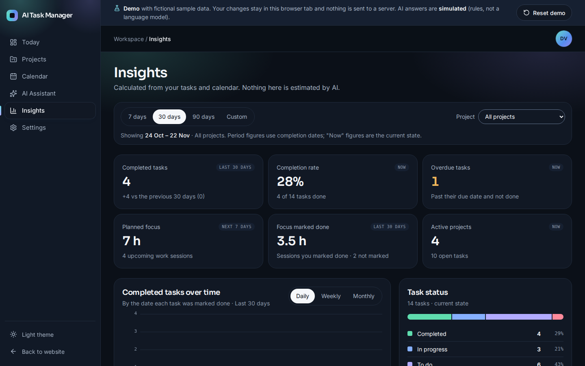
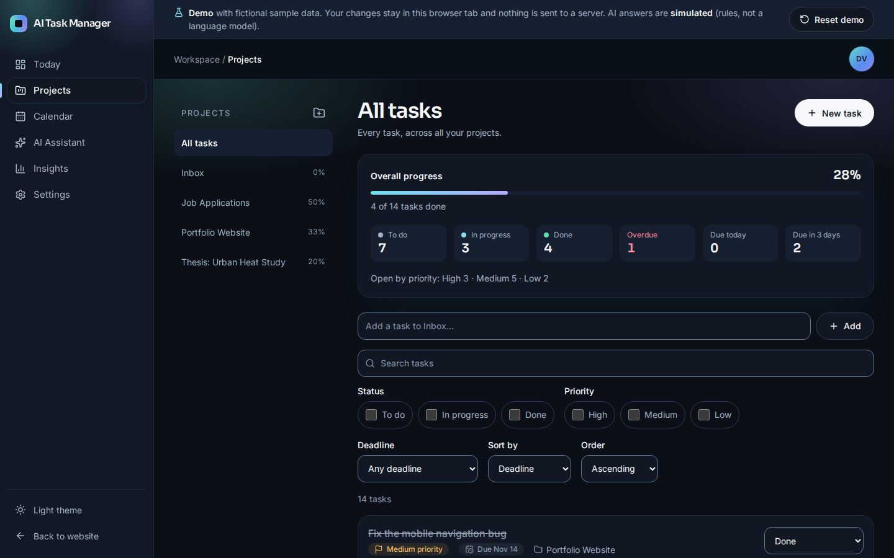
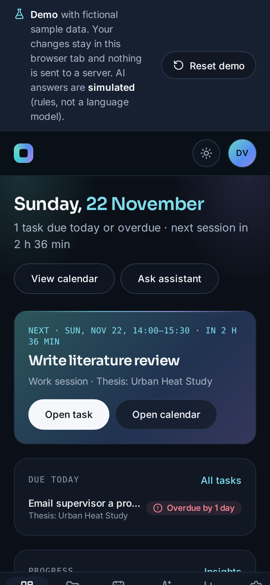
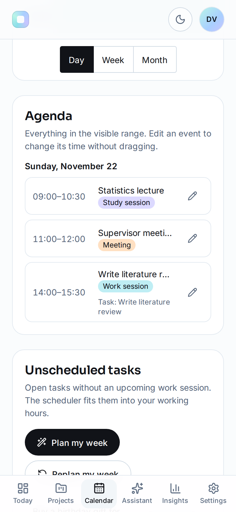

# AI Task Manager

**Plan smarter. Organize better. Get things done.**

A full-stack productivity app: projects, tasks and subtasks, a calendar with a scheduling engine that finds time for your work, an AI assistant whose suggestions only change anything after you approve them, and insights into your progress. Built from scratch as a learning and portfolio project, with a focus on clean architecture, security and tests.

**Live demo:** [ai-task-manager-mauve-one.vercel.app](https://ai-task-manager-mauve-one.vercel.app) · no account needed, runs entirely in your browser with fictional sample data



## Try the demo

Open the live demo and click **View demo**. It is the real application interface running on fictional sample data:

- Explore **Today**, **Projects**, **Calendar**, **AI Assistant**, **Insights** and **Settings**, on desktop or phone.
- Create and edit tasks, move calendar events, let the scheduler propose work sessions, and approve an AI suggestion (try *“Set Apply to Northwind Labs to high priority”*).
- Your changes stay in that browser tab only. Nothing is sent to a server, and **Reset demo** starts over.

The demo's AI answers are **simulated** (rule-based, in your browser): no language model is called. The full application connects to Claude; see [Running the full stack](#running-the-full-stack-locally).

## Screenshots

| | |
|---|---|
|  |  |
| **Landing page** | **Calendar** with linked work sessions |
|  |  |
| **AI assistant**: changes wait for approval | **Insights**, dark theme |
|  |   |
| **Projects**: progress, filters, priorities | **On a phone** |

Screenshots are generated from the demo build with `npm run screenshots`.

## Features

- **Projects, tasks and subtasks**: statuses, priorities, deadlines, effort estimates, checklists, task dependencies, and search, filters and sorting kept in the URL.
- **Calendar**: day, week and month views with drag and drop; categories; daily, weekly and monthly repeats with “this / following / all” edits; correct across time zones and daylight saving; an agenda list as the keyboard-accessible alternative to dragging.
- **Smart scheduling**: a deterministic engine fits open work into your working hours around existing events (deadlines first, then priority), respects dependencies, never overbooks, explains what doesn't fit, and only counts sessions you mark done.
- **AI workspace**: an assistant that answers from your own data, a goal-to-project plan builder, and help on single tasks. Every AI change is a stored **proposal** you approve or dismiss; approvals are atomic, re-validated and can't be applied twice.
- **Insights**: completion trends, focus time, workload against capacity and rule-based suggestions, filterable by period and project.
- **Accounts and security** (full stack): email and password sign-up with email confirmation, password reset, database sessions in HttpOnly cookies, CSRF and rate-limit protection, and per-user data isolation proven by tests.
- **Design**: light and dark themes, responsive from 320 px, WCAG AA contrast, full keyboard support and visible focus.

## Architecture

```
React UI (pages, components)
   │  TanStack Query hooks
   ▼
Repository interfaces (src/data) ──── HTTP adapters ──► Hono API (server/) ──► PostgreSQL (Drizzle)
   │                                                       │
   │                                                       └─ AI provider interface: Claude or Demo AI
   └──── browser adapters (src/demo) ◄── the static portfolio demo
                │
                ▼
     Pure domain logic (src/domain): validation, scheduling, recurrence, insights, proposals
```

- **Business rules live in pure, tested functions** (`src/domain/`) with no React and no I/O, shared by the browser and the API. The clock and ids are injected, so tests are deterministic.
- **The UI only talks to repository interfaces.** The full app uses HTTP adapters; the demo swaps in browser-only adapters at build time (`VITE_DEMO=1`) without changing a single screen.
- **All external input is validated with Zod** at the boundary, including AI output, which is treated as untrusted.
- **The API takes the user only from the server session.** Every query is scoped by user id; another user's data answers 404.
- **AI cost is capped**: per-user daily limits plus an app-wide spending ledger with atomic reservations; the clearly labelled Demo AI takes over when the cap is reached.

More detail: [docs/architecture.md](docs/architecture.md) (data model, security model, decision log) and [docs/design.md](docs/design.md) (design system).

## Tech stack

| Area | Technology |
|---|---|
| Frontend | React 19, TypeScript (strict), Vite, Tailwind CSS v4, React Router, TanStack Query |
| Validation | Zod, shared by the frontend and the API |
| Calendar | FullCalendar 6 (MIT) with the Luxon time-zone plugin |
| API | Hono on Node.js |
| Database | PostgreSQL on Neon, Drizzle ORM with committed migrations; PGlite (PostgreSQL in WebAssembly) for tests |
| Auth | Better Auth: email and password, database sessions, rate limiting |
| AI | Provider interface with a Claude adapter (`@anthropic-ai/sdk`, structured output) and a free Demo AI |
| Testing | Vitest, React Testing Library, PGlite API tests, Playwright end-to-end tests (desktop and phone) |
| Quality | oxlint (including accessibility rules), GitHub Actions CI on every pull request |
| Hosting | Vercel Hobby (static demo) |

## Testing

| Suite | What it covers |
|---|---|
| Unit and component tests (Vitest, ~670) | Domain rules, repositories, API routes on a real in-memory PostgreSQL, authentication flows, cross-user isolation, UI behaviour, the demo's data layer |
| End-to-end, full stack (Playwright) | Sign-up with email confirmation, password reset, sessions, tasks, calendar, scheduling, AI proposals and isolation between two users, on desktop and phone |
| End-to-end, demo (Playwright) | Every screen on desktop and phone, under the production security headers; fails on any network request outside the site |

CI runs lint, typecheck, all tests and both builds on every pull request.

## Running the demo locally

Requires **Node.js 26** (see `.nvmrc`). On Windows, use [WSL](https://learn.microsoft.com/windows/wsl/install).

```bash
git clone https://github.com/eliasbandak321-svg/ai-task-manager.git
cd ai-task-manager
npm install
npm run build:demo     # the static demo, into dist-demo/
npm run preview:demo   # http://localhost:5173 → “View demo”
```

No database, accounts or API keys are needed. For live reload while editing: `VITE_DEMO=1 npm run dev:web`.

## Running the full stack locally

The full application needs a PostgreSQL database. The quickest start uses the embedded one:

```bash
cp .env.example .env   # then set BETTER_AUTH_SECRET (openssl rand -base64 32); keep the file private
npm run dev:offline    # app and API with an embedded PostgreSQL (PGlite) in .data/pglite
```

Open http://localhost:5173. Confirmation and reset emails are printed in the terminal running the API.

- **Neon PostgreSQL:** set `DATABASE_PROVIDER=neon`, `DATABASE_URL` (a development branch's connection string) and `NEON_BRANCH_ID` in `.env`, then `npm run dev`. The API refuses any other branch.
- **AI:** by default the free Demo AI answers. To use Claude, set `AI_PROVIDER=anthropic` and `ANTHROPIC_API_KEY`; this costs money per request, so set a spending limit on the key first. Tests always use the Demo AI.

All settings are documented in [`.env.example`](.env.example). Secrets stay in `.env`, which is git-ignored.

| Command | What it does |
|---|---|
| `npm run dev` / `npm run dev:offline` | App and API with auto-reload (Neon / embedded PGlite) |
| `npm run build` / `npm run build:demo` | Production build of the full app / the static demo |
| `npm run preview` / `npm run preview:demo` | Serve a build locally |
| `npm run lint` · `npm run typecheck` | oxlint · TypeScript |
| `npm run test:run` | All unit, component and API tests |
| `npm run test:e2e` · `npm run test:e2e:demo` | End-to-end tests (first time: `npx playwright install --with-deps chromium`) |
| `npm run screenshots` | Regenerate the README screenshots from the demo build |
| `npm run db:generate` · `npm run db:migrate` | Create / apply database migrations (`db:migrate` is the only way migrations run) |
| `npm run db:backup` | Verified, read-only database snapshot into `.backups/` (before every migration) |
| `npm run ai:usage` | AI requests, tokens and cost per day (counts only, no content) |

## Project status

Built in milestones, each on its own branch and pull request:

- [x] M1–M3: setup, design phase, design system and landing page, CI
- [x] M4–M5: domain logic (test-first) and a functional dashboard
- [x] M6–M8: Hono API, PostgreSQL and Drizzle, Better Auth, password reset, end-to-end tests, security review
- [x] M9: AI workspace, calendar and scheduling engine
- [x] M10: complete visual redesign (light and dark themes, new landing page and app shell)
- [x] M11: public portfolio demo (static, browser-only)

**Next:** a public full-stack deployment (accounts, real email, Google sign-in), prepared on a separate branch.

## What I learned

Designing a layered architecture (pure domain → repositories → API), writing tests first for business rules, building secure authentication and per-user isolation, treating AI output as untrusted input, accessible UI design, and professional Git and CI workflows. The project was developed with AI pair programming (Claude Code), with every change reviewed, tested and approved by me.
