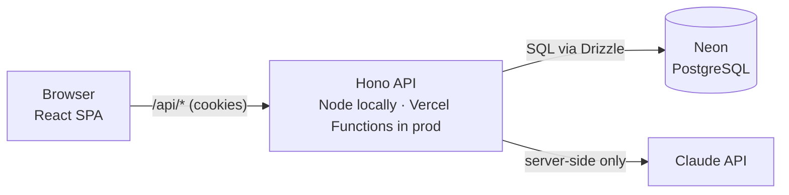
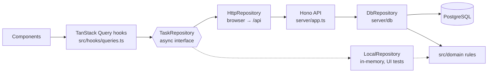

# Architecture

How AI Task Manager is built and why. This file is the source of truth for technical decisions; `docs/design.md` covers the visual design.

**Status:** Approved 2026-11-10. Sections marked *(planned)* describe code that doesn't exist yet. They are updated when each milestone is built.

## 1. Overview

A single repository. The browser app and the API are served from the same origin: through a Vite dev-server proxy on localhost during development, and from one Vercel project after the public release (M11).



**Why one origin?** When the frontend and the API share a domain, the browser sends the login cookie automatically. That means no CORS (cross-origin) configuration, no tokens stored in JavaScript, and one deployment to manage.

## 2. Technology choices

| Technology | Role | Why this one |
|---|---|---|
| React + Vite (SPA) | User interface | Already in place. A single-page app is enough: the landing page doesn't need server rendering for this project's goals. |
| React Router *(M5)* | Client-side pages (`/`, `/app/...`) | Standard routing for React SPAs. Used in declarative mode (`<BrowserRouter>` + `<Routes>`): we load data with TanStack Query, so the router's data APIs aren't needed. |
| TanStack Query *(M5)* | Server state: fetching, caching, loading and error states, refetching after changes | Avoids hand-written `useEffect` + `useState` fetching code, which is a common source of bugs (race conditions, stale data). |
| Zod *(M4)* | Validates data at every boundary (form input, API requests, AI output) | One schema gives both a runtime check and a TypeScript type, and the same schema is shared by the frontend and the API. |
| Hono *(M6)* | HTTP API framework | Small, fast and TypeScript-first. The same app runs on Node locally and on Vercel Functions in production, and the API is plain code that is easy to test. |
| **Neon** PostgreSQL *(M6)* | Database provider | Chosen provider (decided 2026-11-11). Real PostgreSQL on a free tier, with **branches**: a `development` branch for local development now, and a separate `production` branch reserved for the public release (M11). Branches are isolated copies, so development can never touch production data. |
| Drizzle ORM *(M6)* | Typed database queries and migrations | Close to SQL, so you learn SQL rather than hide it. Queries are type-checked against the schema, and schema changes are versioned migration files. |
| Better Auth *(M7)* | Accounts, sessions, password hashing (password reset in M8) | Open source, running inside our own API, not a hosted service: account data stays in our database (Neon), we can see how auth works, and we don't write security-critical crypto ourselves. Telemetry is explicitly disabled. |
| PGlite *(M6)* | In-process PostgreSQL for automated tests | Real PostgreSQL compiled to WebAssembly, running inside Node. Every automated test uses an in-memory instance, so tests run offline, in CI, and never touch Neon. Also available for offline development when chosen explicitly (`npm run dev:offline`), storing data in `.data/pglite`; never as a silent fallback. |
| node-postgres (`pg`) *(M6)* | Driver for Neon (and any PostgreSQL server) | Used when `DATABASE_URL` is set. The full repository contract passes over this driver, both locally and against the Neon development branch (`npm run test:neon`). |
| tsx, concurrently *(M6)* | Run the TypeScript API in development | `npm run dev` starts Vite and the API together; tsx runs and reloads the server without a build step. |
| Playwright *(M8)* | End-to-end tests in a real browser | Verifies complete user flows (sign up, then create a project and a task). |
| Claude API *(M9)* | AI Task Breakdown | Called only from the server, so the API key never reaches the browser. Structured output is validated with Zod before anyone sees it. |

Exact versions are checked for compatibility when each milestone starts.

## 3. Repository layout

```
src/
  domain/        Pure business logic and Zod schemas (no React, no I/O). Shared with the API. Built in M4.
  data/          Repository interface plus adapters: HTTP (used by the app) and local (used by UI tests)
  components/    React components (one per file): landing page at the top level,
    dashboard/   dashboard features (task list, dialogs, navigation, …)
    ui/          generic building blocks (Button, Dialog, Field, ProgressBar, states)
  hooks/         React hooks, including TanStack Query hooks over the repository
  lib/           UI helpers without React: URL filters, labels and error messages
  pages/         Route-level components: LandingPage, DashboardApp (lazy), TasksPage
  test/          Test setup, factories and the shared repository contract
server/
  app.ts         The Hono app: middleware, routes, error handling (no knowledge of where it runs)
  auth.ts        Better Auth configuration, and how a request's user is resolved (the session cookie)
  errors.ts      One JSON error format and the HTTP status for each error code
  env.ts         Environment variables, validated with Zod at startup
  dev.ts         Local Node entry point (npm run dev:api)
  db/            Drizzle schema, connection (Neon via node-postgres, or PGlite), branch check, DbRepository, sign-up helper
  test/          Test database helpers
api/             Vercel Functions entry point that mounts the same Hono app (M11)
drizzle/         Generated SQL migrations (committed)
docs/            design.md, architecture.md
```

## 4. Data model *(built in M6)*

| Table | Key fields | Notes |
|---|---|---|
| `user` | `id`, `name`, `email`, `emailVerified`, `image`, `createdAt`, `updatedAt` | One row per account (Better Auth). Deleting a user deletes all of their data (cascade). |
| `session` | `id`, `userId`, `token`, `expiresAt`, `ipAddress`, `userAgent`, … | One row per signed-in browser. Signing out deletes it, which invalidates the cookie immediately. |
| `account` | `id`, `userId`, `providerId`, `accountId`, `password`, … | How a user signs in. For email and password, `password` is a salted scrypt hash. |
| `verification` | `id`, `identifier`, `value`, `expiresAt` | Short-lived tokens (password reset links in M8). |
| `rate_limit` | `key`, `count`, `lastRequest` | Brute-force counters for the auth endpoints, in the database so they survive restarts and serverless instances. |
| `project` | `id`, `userId`, `name`, `isInbox`, `createdAt`, `updatedAt` | Each user has exactly one Inbox, created at sign-up; it cannot be deleted. |
| `task` | `id`, `userId`, `projectId`, `title`, `description?`, `status`, `priority`, `dueDate?`, `completedAt?`, `createdAt`, `updatedAt` | `status`: `todo` / `in_progress` / `done`. `priority`: `low` / `medium` / `high`. |
| `subtask` | `id`, `userId`, `taskId`, `title`, `done`, `position` | One level only: a checklist. |

**Rules:**
- **Every owned row stores `userId`**, even where it could be derived through a join. This gives one simple, auditable security rule: every query filters by the current user's ID.
- A task's project must belong to the same user, and a subtask's task must too. This is enforced by the domain functions, and again by the database: composite foreign keys `(project_id, user_id) → project(id, user_id)` and `(task_id, user_id) → task(id, user_id)` make a cross-user reference impossible to store.
- **Database constraints are a second line of defence** behind the domain rules: one Inbox per user (partial unique index), project names unique per user ignoring case (`lower(name)`), valid statuses and priorities, length limits, `completed_at` set exactly when the task is done, and cascading deletes. Schema source: `server/db/schema.ts`; migrations: `drizzle/`.
- **`dueDate` is a date without a time** (`YYYY-MM-DD`). Deadlines are calendar days, and storing a timestamp would shift dates for users in other time zones.
- **Deleting a project deletes its tasks and their subtasks.** The UI shows the counts from `planProjectDeletion` and asks for confirmation. Deleting a task deletes its subtasks.

### Domain rules (implemented in M4, `src/domain/`)

| Area | Rule |
|---|---|
| Projects | Names are unique per user, compared case-insensitively after trimming, with locale-independent lowercasing so browser and server always agree. "Inbox" is reserved. The Inbox can't be renamed or deleted. |
| Tasks | Any status can change to any other. `completedAt` is set when a task becomes Done, cleared when it leaves Done, and kept while it stays Done; users can never set it. Completing every subtask does **not** complete the task. Moving a task is only allowed to a project of the same user. |
| Subtasks | Max 50 per task. New subtasks go last. `position` only defines the order: deletes leave gaps, reorders renumber 0…n-1. |
| Deadlines | Relative to the user's local "today" (`toIsoDate(now, timeZone)`). States: overdue, due today, due soon (1–3 days), upcoming, none. Done tasks are never overdue. |
| Statistics | Counts by status, open tasks by priority, overdue / due today / due soon, and completion % rounded *down* (100% only when everything is done). |
| Search, filter, sort | One validated `TaskQuery` object. Search is case- and accent-insensitive, and every word must match the title or description. Filters combine with AND. Sorting by deadline puts undated tasks last in both directions. Ties are broken by creation time, then id, so the order is always deterministic. |
| Limits | Project name 80, task title 200, description 5000, subtask title 200, search 200 characters. Shared by browser and API through the Zod schemas. |

**Design choices that keep the domain testable:**
- Functions are **pure**. Ids and the current time are passed in through a `CreateContext`, never generated inside the function; an architecture test (`src/domain/architecture.test.ts`) fails if a domain file imports anything but Zod, or uses I/O, randomness or the clock.
- Updates return the **same object** when nothing changes, so callers can skip saving.
- Rule violations throw a `DomainError` with a stable `code` (e.g. `NOT_FOUND`, `INBOX_PROTECTED`), which the API maps to HTTP statuses and the UI to messages.
- Functions that combine data re-check ownership (`userId`) as **defence in depth**, even though the API will already scope every query.
- Input schemas are **strict**: unknown keys such as `userId` or `completedAt` are rejected (mass-assignment protection).

## 5. Frontend data flow *(built in M5)*



**Why a repository interface?** Components never know where data lives. In M5 the dashboard ran on a local adapter; in M6 it switched to the HTTP adapter by changing one line (`src/pages/DashboardApp.tsx`), and no component changed. Because the interface is **async from day one**, loading and error states are built into the UI from the start, not bolted on later.

**How it fits together:**

| Piece | Role |
|---|---|
| `src/data/repository.ts` | The `TaskRepository` interface: one method per REST endpoint. No method takes a `userId`: each adapter is already bound to one user (on the server, from the session). |
| `src/test/repositoryContract.ts` | One shared test suite describing how *any* repository must behave (validation, rules, cascades, not-found). It runs four times: LocalRepository, DbRepository on PGlite, DbRepository on node-postgres, and HttpRepository → API → database. All four behave identically. |
| `src/data/httpRepository.ts` | The adapter the app uses (M6). Validates input with the shared schemas before sending, validates every response, turns API error codes back into `DomainError`s, and reports network or server failures as `RepositoryError`s with a safe message. |
| `src/data/localRepository.ts` | The M5 adapter, kept as the fast in-memory backend for the UI tests. It validates every input with the shared Zod schemas, applies every rule through `src/domain` (no rules are re-implemented), scopes every read and write to one user id, and validates saved data on load (it's external input too). The first visit creates a local user with an Inbox, like a sign-up. |
| `src/pages/DashboardApp.tsx` | The only place that chooses the adapter. It is lazy-loaded, so landing-page visitors never download the dashboard, React Query or Zod. |
| `src/hooks/queries.ts` | TanStack Query hooks: one cached list per resource (`projects`, `tasks`, `subtasks`). After a write, the affected lists are invalidated and refetched, so the UI shows exactly what was stored (including values the domain computes, like `completedAt`). Status changes, subtask check-offs and reordering are optimistic, with rollback on error. |
| `src/lib/taskFilters.ts` | Search, filters and sorting live in the URL and are parsed with the domain's `taskQuerySchema`; invalid values fall back to defaults. |

**Filtering happens in the browser** (`queryTasks` from the domain) on the user's full task list. That's fast for one person's tasks; if lists grow large, the same `TaskQuery` can move to API query parameters.

### The API *(built in M6)*

| Method and path | Purpose | Success |
|---|---|---|
| `GET /api/health` | Is the API up? (no user needed) | 200 |
| `GET /api/projects` · `POST /api/projects` | List, create | 200 · 201 |
| `PATCH /api/projects/:id` · `DELETE /api/projects/:id` | Rename; delete with its tasks and subtasks | 200 · 204 |
| `GET /api/tasks` · `POST /api/tasks` | List, create | 200 · 201 |
| `PATCH /api/tasks/:id` · `DELETE /api/tasks/:id` | Update (including status and moving); delete with its subtasks | 200 · 204 |
| `GET /api/subtasks` · `POST /api/tasks/:taskId/subtasks` | List, add | 200 · 201 |
| `PUT /api/tasks/:taskId/subtasks/order` | Reorder (`{ "orderedIds": [...] }`) | 200 |
| `PATCH /api/subtasks/:id` · `DELETE /api/subtasks/:id` | Rename or check off; delete | 200 · 204 |

**Request pipeline:** security headers and `Cache-Control: no-store` → body size limit (64 kB) → resolve the user (401 if none) → a `DbRepository` bound to that user → JSON. Routes contain no rules: the repository validates every body with the shared Zod schemas and applies `src/domain`.

**Errors** always look like `{ "error": { "code", "message", "issues"? } }`:

| Status | Codes |
|---|---|
| 400 | `VALIDATION_ERROR` (with `issues`), `INVALID_JSON`, `RESERVED_PROJECT_NAME`, `INVALID_SUBTASK_ORDER` |
| 401 | `UNAUTHENTICATED` |
| 403 | `FORBIDDEN_ORIGIN` — a state-changing request from another website (CSRF check) |
| 404 | `NOT_FOUND` — missing, another user's, or not even a valid id |
| 409 | `DUPLICATE_PROJECT_NAME`, `INBOX_PROTECTED`, `SUBTASK_LIMIT_REACHED` |
| 413 · 415 | `PAYLOAD_TOO_LARGE` · `UNSUPPORTED_MEDIA_TYPE` (bodies must be JSON) |
| 500 | `INTERNAL_ERROR` — a generic message; details are only logged on the server |

**Authentication (M7):** Better Auth handles `/api/auth/*`; every other route asks `ResolveUserId` who the user is, and in the app that's `sessionUser` (`server/auth.ts`), which reads the session cookie. Routes and repositories never see anything but the resulting user id.

| Auth endpoint (Better Auth) | Purpose |
|---|---|
| `POST /api/auth/sign-up/email` | Create an account (name, email, password); signs in and creates the user's Inbox |
| `POST /api/auth/sign-in/email` | Sign in; sets the session cookie |
| `POST /api/auth/sign-out` | Sign out; deletes the session on the server |
| `GET /api/auth/get-session` | The signed-in user, or `null` |

In the browser, `src/data/authClient.ts` (`HttpAuthClient`) wraps these endpoints, `src/hooks/auth.ts` keeps the session in TanStack Query, and `RequireAuth` guards `/app`. Signing in, up or out replaces the whole query cache, so one user's data is never shown to the next person on the same browser. Any `401` from the API clears the session and returns the user to `/login?next=…` (only paths inside `/app` are accepted as `next`, to prevent open redirects).

## 6. Security model *(essential, not optional)*

| Rule | How |
|---|---|
| **Authentication** | Better Auth (M7): email and password, sessions stored in the database. The session cookie is `HttpOnly` (JavaScript, and so XSS, can't read it), `SameSite=Lax`, `Path=/`, lasts 7 days and is extended while in use, and is `Secure` with the `__Secure-` prefix in production (HTTPS required by configuration). Signing out deletes the session server-side, so a copied cookie stops working. Signed with `BETTER_AUTH_SECRET`. |
| **CSRF** | Three layers: `SameSite=Lax` cookies; an Origin check on every POST, PUT, PATCH and DELETE (requests from untrusted origins get `403` and are logged; `Sec-Fetch-Site` covers requests without Origin), plus Better Auth's own trusted-origin check, both using the same list (`trustedOrigins` in `server/env.ts`): in production exactly `APP_ORIGIN`; in development with a local `APP_ORIGIN` also the other names of this computer (`localhost`, `127.0.0.1`, `[::1]`) on the same scheme and port, because tools open the dev server under either name; and JSON-only request bodies, which HTML forms on other sites can't send. |
| **Email verification** | Required (M8). Sign-up creates the account and emails a confirmation link (24 hours); signing in to an unconfirmed account fails and sends a fresh link. Opening the link confirms the address and starts a session once; the link can't be reused to sign in. |
| **Account enumeration** | Sign-in, sign-up and password reset answer the same way whether or not the email is registered. Signing up with a registered email sends its owner a "someone tried to sign up" notice instead. Emails are sent in the background, so response times don't reveal it either. |
| **User isolation** | The user ID comes **only from the session**, never from the request body or URL. Every query is scoped with `where userId = currentUser`. |
| **Isolation tests** | Each resource has tests proving user A cannot read, update or delete user B's data. |
| **Not found, not forbidden** | Another user's resource returns `404`, so the API doesn't reveal that it exists. |
| **Input validation** | Every request body and query parameter is parsed with Zod; anything else is rejected with `400`. |
| **Rate limiting** | Per client IP, stored in the `rate_limit` table: sign-in and sign-up 5 per minute, password-reset and verification emails 3 per minute, setting a new password 5 per minute, other auth endpoints 100 per minute. The AI endpoint gets a daily quota per user (M9). |
| **Client IP** | Read from `CLIENT_IP_HEADER` (default `X-Forwarded-For`). Entries added by `TRUSTED_PROXIES` (our own proxies; in development this computer, i.e. the Vite proxy) are stripped from the right; the first untrusted address is the client. Addresses a client writes into the header itself are never trusted. Production refuses to start without an explicit setting (see the M11 checklist). |
| **Redirects** | Every `redirectTo` / `callbackURL` sent to `/api/auth/*` (body or query, any method) must be a path on this site or a trusted origin; otherwise `400 UNSAFE_REDIRECT`. Better Auth checks this too, and its checks are forced on even in tests. |
| **Secrets** | Only in environment variables, never committed. Only `VITE_`-prefixed variables reach the browser, so secrets must never use that prefix. The Neon connection string lives in the git-ignored `.env` (file mode 600) and is never logged: the API prints only the verified branch ID. Connections use `sslmode=verify-full`. |
| **Passwords** | 8–128 characters, hashed by Better Auth with salted scrypt; never stored or logged in plain text. **Reset (M8):** a random single-use token, valid 15 minutes, delivered by email; using it signs the account out on every device. Reset links may only point to this app (redirect check), and requests are rate limited. |
| **AI output** | Treated as untrusted data. It is validated, shown to the user as a draft, and saved only after explicit approval. |
| **Release gate** | Nothing is deployed publicly before M11. The release requires the M7–M8 auth, isolation and security checks to pass. |

### Security audit (M8)

| # | Finding | Severity | Status |
|---|---|---|---|
| 1 | **Better Auth silently disables its origin, redirect and CSRF checks in test environments.** Our tests therefore verified weaker behaviour than production; with the checks off, a password-reset request with an attacker's `redirectTo` produced an email whose link sent the reset token to the attacker (password-reset poisoning). The real server was not affected (verified: `403 INVALID_REDIRECT_URL`). | High (test gap; would hide regressions) | Fixed: checks forced on (`disableOriginCheck: false`, `disableCSRFCheck: false`), plus our own redirect check for all methods; regression tests |
| 2 | **Multi-hop `X-Forwarded-For` without trusted proxies → one shared rate-limit bucket.** Better Auth then trusts no address and, in production, puts every client in one bucket: five failed sign-ins per minute from anyone would lock everyone out. | High (production) | Fixed: `CLIENT_IP_HEADER` / `TRUSTED_PROXIES`, this computer trusted in development, production refuses to start without explicit configuration; tests prove a faked header can't dodge the limit |
| 3 | **Sign-up revealed whether an email is registered** (`422 already exists`). | Medium | Fixed: email verification required; identical sign-up responses; owner notified |
| 4 | Password reset: tokens, expiry, single use, session revocation, enumeration, timing, rate limits | — | Implemented and tested (server, client and end-to-end) |
| 5 | Sessions, cookies, CSRF, authorization, user isolation (M7) | — | Re-audited; added tests for expired sessions, the raw session token not authenticating, and reusing confirmation links |

**Accepted for now (revisit later):**
- Rate limits are per IP, not per account; a distributed attack on one account isn't slowed by them. Candidates: per-email limits, a CAPTCHA after repeated failures.
- No list of active sessions or "sign out everywhere" button; a password reset does sign out everywhere.
- No check against known breached passwords (would need an external service; ask before adding).
- Response *timing* of sign-in for unknown vs known emails is Better Auth's; only the responses themselves are tested to be identical.

### M11 deployment checklist (security)

Production **refuses to start** until the items marked ⛔ are done (`server/env.ts`). Reviewed at the end of M8.

| Item | What to set |
|---|---|
| ⛔ Production mode | `NODE_ENV=production`. Every production safeguard (one trusted origin, `Secure` cookies, required email provider and client-IP settings, no PGlite, migrations need confirmation) keys off it |
| ⛔ HTTPS origin | `APP_ORIGIN=https://…` on the public domain (cookies become `Secure` with the `__Secure-` prefix; links in confirmation and reset emails are built from it) |
| ⛔ Email provider | A real `Mailer` (e.g. SMTP or an email API) and its secrets; `MAIL_TRANSPORT=console/file` is rejected |
| ⛔ Client IP | On Vercel: `CLIENT_IP_HEADER=x-real-ip` (or `x-vercel-forwarded-for`), which Vercel sets itself; or `TRUSTED_PROXIES` for the proxies in front of the API. Verify with a test request that limits are per client |
| ⛔ Database | `DATABASE_PROVIDER=neon`, the **production** branch's `DATABASE_URL` and `NEON_BRANCH_ID`; migrations run as a deliberate release step (`--confirm-production=<branch>`) |
| Secret | A new `BETTER_AUTH_SECRET` (never reuse the development one) |
| Email sender | `MAIL_FROM` on a domain with SPF/DKIM/DMARC configured |
| Static site headers | CSP, HSTS, `X-Content-Type-Options`, `Referrer-Policy` for the SPA (the API already sends security headers) in `vercel.json` |
| Rate limit table | Schedule cleanup of old `rate_limit` rows. Keys include the request path, and for reset links that path contains the (single-use, 15-minute) token, so rows accumulate per link |
| Keep checks on | Never set `disableOriginCheck` / `disableCSRFCheck`, or loosen the redirect check in `server/app.ts`; they're forced on deliberately (M8 audit, finding 1) |
| Separate data | Never copy development data (Neon `development` branch, `.backups/`, PGlite) into production; production starts empty from the migrations |
| Re-run | `npm run test:e2e` against a preview deployment, and the isolation tests |

## 7. AI Task Breakdown flow *(M9)*

1. The user describes a goal, and the client calls `POST /api/ai/breakdown`.
2. The server checks the session and the daily quota, then calls the Claude API asking for structured output (a list of tasks, each with optional subtasks).
3. The response is validated with Zod and returned as a **draft**. Nothing is saved.
4. The user edits, removes or reorders the draft tasks, then approves.
5. The client sends the approved tasks to the normal create endpoint, which runs the same validation and ownership checks as any other write.

A single server endpoint, with no agents or orchestration: the feature doesn't need more.

## 8. Testing strategy

| Layer | Tool | What is tested |
|---|---|---|
| Domain logic | Vitest | Status transitions, statistics, search, filtering, sorting, deadline rules: pure functions, test-first |
| Components | Vitest + React Testing Library | User-visible behaviour, accessibility queries (`getByRole`) |
| API | Vitest + PGlite | Each endpoint: validation, ownership, isolation between users |
| End to end | Playwright (M8), `npm run test:e2e` | Registration with email confirmation, login, logout, password reset, sessions ending elsewhere, projects/tasks/subtasks, isolation between users, error states, phone layouts. Production build + real API on a temporary PGlite database; also in CI |
| AI | Vitest with a mocked model response | Validation, draft handling, quota; no real API calls in CI |

CI (GitHub Actions) runs lint, typecheck, tests and the build on every pull request and every push to `main`.

## 9. Environments

| Environment | Source | Notes |
|---|---|---|
| Local (M3–M10) | `npm run dev` in WSL, on localhost: Vite on :5173 proxies `/api` to the API on 127.0.0.1:8787, which uses the **Neon `development` branch** (`DATABASE_PROVIDER=neon`, `DATABASE_URL` and `NEON_BRANCH_ID` in the git-ignored `.env`). Offline work uses PGlite only when chosen explicitly (`npm run dev:offline`) | All development and testing |
| CI (throughout) | GitHub Actions on every PR and every push to `main` | Lint, typecheck, tests, production build |
| Production (M11) | Vercel, deployed from `main`, using the Neon **`production`** branch | Public release after the final redesign and testing. Nothing touches the production branch before then |

Only free tiers are used. Enabling any paid service requires explicit approval first.

### Database setup (Neon)

1. Neon project on the Free plan with two branches: `development` (local work) and `production` (reserved for M11).
2. Copy `.env.example` to `.env` and set `DATABASE_PROVIDER=neon`, `DATABASE_URL` to the **development** branch's direct connection string (with `sslmode=verify-full`), and `NEON_BRANCH_ID` to that branch's ID (Neon Console → Branches → development).
3. `npm run dev` runs `npm run db:migrate` once, then starts the web app and the API.
4. `npm run test:neon` (optional) runs the repository contract against the development branch and deletes its test users afterwards. All other tests use PGlite.

**The database is always chosen explicitly** (`DATABASE_PROVIDER`, no default, no fallback):

| Provider | Needs | Used for |
|---|---|---|
| `neon` | `DATABASE_URL` on a `*.neon.tech` host and `NEON_BRANCH_ID` | The project's database (development branch now, production branch in M11) |
| `postgres` | `DATABASE_URL` (not Neon) | Any other PostgreSQL server |
| `pglite` | nothing (data in `PGLITE_DIR`) | Explicit offline development: `npm run dev:offline`. Refused in production |

A missing `.env`, a missing provider, or an incomplete Neon configuration stops the API with a clear message; it never quietly switches to an empty local database. Configuration errors never include the connection string. Automated tests create their own in-memory PGlite databases and never read `.env`.

### Migrations

| Rule | Enforced by |
|---|---|
| **Servers never apply migrations.** At startup they only check (read-only) that the schema matches the committed migrations, and refuse to start otherwise. A restart — including a file-watch restart in development — can't change any schema. | `assertSchemaUpToDate` in `server/db/migrations.ts`, called by `server/dev.ts` (and by the M11 entry point) |
| **Migrations are applied only by `npm run db:migrate`**, an explicit command that shows its target and lists what it applies. | `server/db/migrate.ts` |
| **Neon migrations check the branch first**: a connection to any branch other than `NEON_BRANCH_ID` is refused before any statement runs. | `assertNeonBranch` in `server/db/client.ts` |
| **Production needs explicit confirmation**: with `NODE_ENV=production`, `db:migrate` refuses unless run as `npm run db:migrate -- --confirm-production=<NEON_BRANCH_ID>`, naming the exact branch. This check happens before connecting. | `assertMigrationAllowed` in `server/db/migrationPolicy.ts` |
| **Development convenience**: `npm run dev` runs `db:migrate` once per session (development configuration only), not on restarts. | `package.json` |

In M11, migrating production becomes a deliberate release step, run before deploying the code that needs it; the deployed functions only verify the schema.

### Deployment compatibility (applies from M4 onward)

Deployment is postponed, so we design for it now to avoid surprises in M11:

| Rule | Why |
|---|---|
| **Keep the same origin locally.** The Vite dev server proxies `/api` to the local Hono server. | Production serves the app and the API from one domain. Developing the same way means cookies and URLs behave identically. |
| **Keep the platform entry points thin.** `server/dev.ts` (Node) and `api/` (Vercel) only mount the shared Hono app. | The API code doesn't know where it runs, so switching to Vercel in M11 is a small file, not a refactor. |
| **Write stateless server code.** No in-memory sessions, rate-limit counters or caches, and no writing to the filesystem. | Serverless functions run as many short-lived copies that share no memory. State lives in Postgres. |
| **Configure through environment variables,** validated with Zod at startup; commit `.env.example`, never `.env`. | A missing or wrong variable fails loudly and early, instead of breaking at runtime in production. |
| **Change the schema only through committed Drizzle migrations.** | The production database in M11 is created by running the same migrations. |
| **Make cookie and security settings environment-aware** (e.g. `Secure` cookies in production, allowed on `http://localhost` in development). | Same code, correct behaviour in both places. |
| **Run CI against the production build** (`npm run build` now; end-to-end tests against `vite preview` from M8). | Build-only problems surface on every PR, not on launch day. |
| **Add SPA rewrites in M11** (`vercel.json`). | Client routes like `/app/projects/1` must serve `index.html`. |

## 10. Decision log

| Date | Decision | Reason |
|---|---|---|
| 2026-11-10 | Vite SPA, not Next.js | Already built; avoids a framework migration; the API lives in Vercel Functions |
| 2026-11-10 | Hono, Neon, Drizzle, Better Auth, Zod | Shows real full-stack skills with free tiers and no vendor lock-in for auth |
| 2026-11-10 | `userId` on every owned row | One uniform, testable isolation rule |
| 2026-11-10 | Async repository interface before the backend exists | The dashboard can be built first without being rewritten for the API |
| 2026-11-10 | Every task belongs to a project; a default Inbox per user | One invariant, with no "loose task" special cases |
| 2026-11-10 | Subtasks are a one-level checklist | Covers the need without recursive-task complexity |
| 2026-11-10 | Email and password auth; password reset in M8 | Works for every user type. Locally, reset emails are logged to the console; the email provider comes in M11. |
| 2026-11-10 | Deleting a project deletes its tasks and subtasks, after confirmation | Predictable and simple; the Inbox can't be deleted, so there's always a home for new tasks |
| 2026-11-10 | Timestamps are ISO 8601 UTC strings, not `Date` objects | Identical in memory, in JSON and in the API; no serialisation surprises |
| 2026-11-10 | Public deployment postponed to M11 | Build a complete, tested app first. Localhost and CI until then, with the deployment-compatibility rules in §9. |
| 2026-11-10 | No multi-agent AI architecture | Task Breakdown is a single structured request |
| 2026-11-11 | M6: Neon is the database provider: the `development` branch for local work, `production` reserved for M11; PGlite for automated tests | Real managed PostgreSQL during development, with production data isolated on its own branch. Tests stay fast, offline and free of side effects. Superseded the earlier "PGlite by default" choice; PGlite remains only for tests and explicit offline mode |
| 2026-11-11 | M6: servers never migrate; `db:migrate` is the only path, and production needs `--confirm-production=<branch>` | A restart can never change a schema, and a production migration is always a deliberate, named action |
| 2026-11-11 | M6: `DATABASE_PROVIDER` must be set explicitly (no fallback to PGlite) | A broken Neon configuration fails loudly instead of silently showing an empty local database |
| 2026-11-11 | M6: `NEON_BRANCH_ID` safety check | The API and migrations verify `neon.branch_id` before any query that changes data, so a wrong connection string (e.g. production's) fails immediately instead of migrating or writing |
| 2026-11-11 | M6: one `DbRepository` implements the same `TaskRepository` interface on the server | The API reuses the domain rules and the contract tests; routes stay thin |
| 2026-11-11 | M6: composite foreign keys including `user_id` | Cross-user references are impossible at the database level, not just in code |
| 2026-11-11 | M6: rule errors map to 404/409/400 with stable codes; invalid ids are 404 | The client can rebuild the same `DomainError`; ids that can't exist are simply "not found" |
| 2026-11-11 | M6: the API only accepts JSON bodies | Plain HTML forms on other sites can't send JSON, a first CSRF safeguard before cookies arrive in M7 |
| 2026-11-11 | M7: Better Auth with the Drizzle adapter, UUID ids, database sessions and database rate limiting; the development user is gone | Real accounts with no paid service, data in our own Neon database; the M6 `user` table was already in Better Auth's shape, so the migration only adds tables |
| 2026-11-11 | M7: an Origin check on all state-changing requests, on top of SameSite cookies and JSON-only bodies | Defence in depth against CSRF now that the API is authenticated by cookies |
| 2026-11-11 | M8: email verification required; identical answers for sign-up and reset | Prevents account enumeration (decided with the developer); also proves the address before it receives reset links |
| 2026-11-11 | M8: development email via console or files behind a `Mailer` interface | No paid service now; M11 plugs in a provider without touching auth code; production refuses development transports |
| 2026-11-11 | M8: Better Auth's security checks forced on in every environment; our own redirect check for `/api/auth/*` | Better Auth turns them off under tests, which hid a reset-redirect flaw from the test suite |
| 2026-11-11 | M8: client IP from a configurable header with trusted proxies; production must configure it | Without it, a proxy chain makes every client share one rate-limit bucket |
| 2026-11-11 | M8: Playwright end-to-end tests against the production build, on a temporary PGlite database, in CI | Full user flows in a real browser, isolated from Neon and from local development |
| 2026-11-11 | M7 fix: in development, trust all loopback names of the dev server's origin; Vite's port is fixed (`strictPort`) | Sign-up failed with 403 when the app was opened at `127.0.0.1:5173` instead of `localhost:5173` (same computer, different origin). Production still trusts exactly one origin |
| 2026-11-11 | M7: the UI cache is cleared on every sign-in, sign-up and sign-out | Prevents one user's cached data from flashing up for the next user of the same browser |
| 2026-11-11 | M6: a `user` table shaped like Better Auth's, plus a development user | M7 plugs in real accounts without a data migration; the development user can't run in production |
| 2026-11-10 | M10 is a complete visual redesign of the landing page and dashboard | Decided in the M5 review: the current look is a functional placeholder. Until M10, work goes into a complete, working application |
| 2026-11-10 | M5: project navigation is a sidebar on large screens and a collapsible list on small ones | Projects need a permanent home on desktop; on phones the tasks stay first |
| 2026-11-10 | M5: the dashboard is a lazy-loaded route (`/app/*`) | Keeps the landing page bundle within its 90 kB budget (88.6 kB gzip measured) |
| 2026-11-10 | M5: search, filters and sorting are stored in the URL | Survive reloads, can be bookmarked, work with Back; validated like any input |
| 2026-11-10 | M5: the repository lists all of a user's subtasks in one call | One cache entry feeds task-row progress, the task dialog and deletion counts; a user's data is small |
| 2026-11-10 | M5: one shared contract test suite for every repository adapter | Proves the HTTP adapter (M6) behaves exactly like the local one, so the UI needs no changes |
| 2026-11-10 | M5: dialogs use the native `<dialog>` element | Focus trapping, inert background and Escape come from the browser, not custom code |
| 2026-11-10 | M5: components await `mutateAsync` for follow-up actions | `mutate` callbacks are skipped when a component unmounts first (e.g. a deleted task's dialog) |
