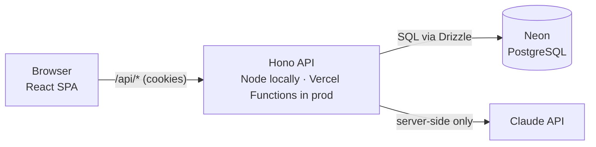
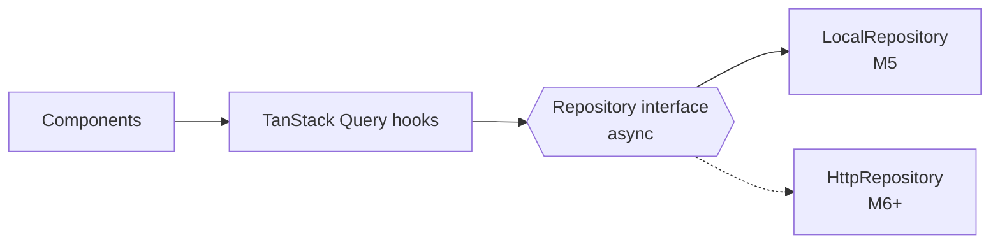

# Architecture

How AI Task Manager is built and why. This file is the source of truth for technical decisions; `docs/design.md` covers the visual design.

**Status:** Approved 2026-11-10. Sections marked *(planned)* describe code that doesn't exist yet. They are updated when each milestone is built.

## 1. Overview

A single repository. The browser app and the API are served from the same origin: through a Vite dev-server proxy on localhost during development, and from one Vercel project after the public release (M11).



**Why one origin?** When the frontend and the API share a domain, the browser sends the login cookie automatically. That means no CORS (cross-origin) configuration, no tokens stored in JavaScript, and one deployment to manage.

## 2. Technology choices

| Technology | Role | Why this one |
|---|---|---|
| React + Vite (SPA) | User interface | Already in place. A single-page app is enough: the landing page doesn't need server rendering for this project's goals. |
| React Router *(M5)* | Client-side pages (`/`, `/app/...`) | Standard routing for React SPAs. |
| TanStack Query *(M5)* | Server state: fetching, caching, loading and error states, refetching after changes | Avoids hand-written `useEffect` + `useState` fetching code, which is a common source of bugs (race conditions, stale data). |
| Zod *(M4)* | Validates data at every boundary (form input, API requests, AI output) | One schema gives both a runtime check and a TypeScript type, and the same schema is shared by the frontend and the API. |
| Hono *(M6)* | HTTP API framework | Small, fast and TypeScript-first. The same app runs on Node locally and on Vercel Functions in production, and the API is plain code that is easy to test. |
| PostgreSQL *(M6)*, Neon in production *(M11)* | Database | Real relational database (foreign keys, transactions). Neon offers a free tier and serverless-friendly connections. The local development database (local Postgres or a free Neon development branch) is decided at the start of M6. |
| Drizzle ORM *(M6)* | Typed database queries and migrations | Close to SQL, so you learn SQL rather than hide it. Queries are type-checked against the schema, and schema changes are versioned migration files. |
| Better Auth *(M7)* | Accounts, sessions, password hashing, password reset | A library running inside our own API, not a hosted service: data stays in our database, and we can see how auth works, without writing security-critical crypto ourselves. |
| PGlite *(M6)* | In-process PostgreSQL for tests | Integration tests run against real Postgres semantics without Docker, which keeps WSL setup simple. |
| Playwright *(M8)* | End-to-end tests in a real browser | Verifies complete user flows (sign up, then create a project and a task). |
| Claude API *(M9)* | AI Task Breakdown | Called only from the server, so the API key never reaches the browser. Structured output is validated with Zod before anyone sees it. |

Exact versions are checked for compatibility when each milestone starts.

## 3. Repository layout *(planned; finalised in M6)*

```
src/
  domain/        Pure business logic and Zod schemas (no React, no I/O). Shared with the API. Built in M4.
  data/          Repository interface plus adapters: local (M5) and HTTP (M6+)
  components/    React components (one per file)
  hooks/         React hooks, including TanStack Query hooks over the repository
  pages/         Route-level components (M5)
server/          Hono app: routes, auth, database access (M6+)
  db/            Drizzle schema and queries
server/dev.ts    Local Node entry point (M6)
api/             Vercel Functions entry point that mounts the same Hono app (M11)
drizzle/         Generated SQL migrations (committed)
docs/            design.md, architecture.md
```

## 4. Data model *(planned)*

| Table | Key fields | Notes |
|---|---|---|
| `user`, `session`, `account`, `verification` | Managed by Better Auth | Auth tables live in our database |
| `project` | `id`, `userId`, `name`, `isInbox`, `createdAt`, `updatedAt` | Each user has exactly one Inbox, created at sign-up; it cannot be deleted. |
| `task` | `id`, `userId`, `projectId`, `title`, `description?`, `status`, `priority`, `dueDate?`, `completedAt?`, `createdAt`, `updatedAt` | `status`: `todo` / `in_progress` / `done`. `priority`: `low` / `medium` / `high`. |
| `subtask` | `id`, `userId`, `taskId`, `title`, `done`, `position` | One level only: a checklist. |

**Rules:**
- **Every owned row stores `userId`**, even where it could be derived through a join. This gives one simple, auditable security rule: every query filters by the current user's ID.
- A task's project must belong to the same user, and a subtask's task must too. This is enforced in the API and covered by tests.
- **`dueDate` is a date without a time** (`YYYY-MM-DD`). Deadlines are calendar days, and storing a timestamp would shift dates for users in other time zones.
- **Deleting a project deletes its tasks and their subtasks.** The UI shows the counts from `planProjectDeletion` and asks for confirmation. Deleting a task deletes its subtasks.

### Domain rules (implemented in M4, `src/domain/`)

| Area | Rule |
|---|---|
| Projects | Names are unique per user, compared case-insensitively after trimming, with locale-independent lowercasing so browser and server always agree. "Inbox" is reserved. The Inbox can't be renamed or deleted. |
| Tasks | Any status can change to any other. `completedAt` is set when a task becomes Done, cleared when it leaves Done, and kept while it stays Done; users can never set it. Completing every subtask does **not** complete the task. Moving a task is only allowed to a project of the same user. |
| Subtasks | Max 50 per task. New subtasks go last. `position` only defines the order: deletes leave gaps, reorders renumber 0…n-1. |
| Deadlines | Relative to the user's local "today" (`toIsoDate(now, timeZone)`). States: overdue, due today, due soon (1–3 days), upcoming, none. Done tasks are never overdue. |
| Statistics | Counts by status, open tasks by priority, overdue / due today / due soon, and completion % rounded *down* (100% only when everything is done). |
| Search, filter, sort | One validated `TaskQuery` object. Search is case- and accent-insensitive, and every word must match the title or description. Filters combine with AND. Sorting by deadline puts undated tasks last in both directions. Ties are broken by creation time, then id, so the order is always deterministic. |
| Limits | Project name 80, task title 200, description 5000, subtask title 200, search 200 characters. Shared by browser and API through the Zod schemas. |

**Design choices that keep the domain testable:**
- Functions are **pure**. Ids and the current time are passed in through a `CreateContext`, never generated inside the function; an architecture test (`src/domain/architecture.test.ts`) fails if a domain file imports anything but Zod, or uses I/O, randomness or the clock.
- Updates return the **same object** when nothing changes, so callers can skip saving.
- Rule violations throw a `DomainError` with a stable `code` (e.g. `NOT_FOUND`, `INBOX_PROTECTED`), which the API maps to HTTP statuses and the UI to messages.
- Functions that combine data re-check ownership (`userId`) as **defence in depth**, even though the API will already scope every query.
- Input schemas are **strict**: unknown keys such as `userId` or `completedAt` are rejected (mass-assignment protection).

## 5. Frontend data flow



**Why a repository interface?** Components never know where data lives. In M5 the dashboard runs entirely on a local adapter. In M6 we swap in the HTTP adapter, and the UI does not change. Because the interface is **async from day one**, loading and error states are built into the UI from the start, not bolted on later.

## 6. Security model *(essential, not optional)*

| Rule | How |
|---|---|
| **Authentication** | Better Auth sessions in `httpOnly`, `Secure`, `SameSite=Lax` cookies. JavaScript can't read them, which limits the damage of XSS. |
| **User isolation** | The user ID comes **only from the session**, never from the request body or URL. Every query is scoped with `where userId = currentUser`. |
| **Isolation tests** | Each resource has tests proving user A cannot read, update or delete user B's data. |
| **Not found, not forbidden** | Another user's resource returns `404`, so the API doesn't reveal that it exists. |
| **Input validation** | Every request body and query parameter is parsed with Zod; anything else is rejected with `400`. |
| **Rate limiting** | On the auth endpoints (brute-force protection) and the AI endpoint (cost control, as a daily quota per user). |
| **Secrets** | Only in environment variables, never committed. Only `VITE_`-prefixed variables reach the browser, so secrets must never use that prefix. |
| **Passwords** | Hashed by Better Auth. Password reset is built in M8. Locally, reset emails are logged to the console; a real email provider is connected in M11 (with approval). |
| **AI output** | Treated as untrusted data. It is validated, shown to the user as a draft, and saved only after explicit approval. |
| **Release gate** | Nothing is deployed publicly before M11. The release requires the M7–M8 auth, isolation and security checks to pass. |

## 7. AI Task Breakdown flow *(M9)*

1. The user describes a goal, and the client calls `POST /api/ai/breakdown`.
2. The server checks the session and the daily quota, then calls the Claude API asking for structured output (a list of tasks, each with optional subtasks).
3. The response is validated with Zod and returned as a **draft**. Nothing is saved.
4. The user edits, removes or reorders the draft tasks, then approves.
5. The client sends the approved tasks to the normal create endpoint, which runs the same validation and ownership checks as any other write.

A single server endpoint, with no agents or orchestration: the feature doesn't need more.

## 8. Testing strategy

| Layer | Tool | What is tested |
|---|---|---|
| Domain logic | Vitest | Status transitions, statistics, search, filtering, sorting, deadline rules: pure functions, test-first |
| Components | Vitest + React Testing Library | User-visible behaviour, accessibility queries (`getByRole`) |
| API | Vitest + PGlite | Each endpoint: validation, ownership, isolation between users |
| End to end | Playwright (M8) | Sign up, create a project and a task, complete it, see progress |
| AI | Vitest with a mocked model response | Validation, draft handling, quota; no real API calls in CI |

CI (GitHub Actions) runs lint, typecheck, tests and the build on every pull request and every push to `main`.

## 9. Environments

| Environment | Source | Notes |
|---|---|---|
| Local (M3–M10) | `npm run dev` in WSL, on localhost | All development and testing |
| CI (throughout) | GitHub Actions on every PR and every push to `main` | Lint, typecheck, tests, production build |
| Production (M11) | Vercel, deployed from `main` | Public release after the final redesign and testing |

Only free tiers are used. Enabling any paid service requires explicit approval first.

### Deployment compatibility (applies from M4 onward)

Deployment is postponed, so we design for it now to avoid surprises in M11:

| Rule | Why |
|---|---|
| **Keep the same origin locally.** The Vite dev server proxies `/api` to the local Hono server. | Production serves the app and the API from one domain. Developing the same way means cookies and URLs behave identically. |
| **Keep the platform entry points thin.** `server/dev.ts` (Node) and `api/` (Vercel) only mount the shared Hono app. | The API code doesn't know where it runs, so switching to Vercel in M11 is a small file, not a refactor. |
| **Write stateless server code.** No in-memory sessions, rate-limit counters or caches, and no writing to the filesystem. | Serverless functions run as many short-lived copies that share no memory. State lives in Postgres. |
| **Configure through environment variables,** validated with Zod at startup; commit `.env.example`, never `.env`. | A missing or wrong variable fails loudly and early, instead of breaking at runtime in production. |
| **Change the schema only through committed Drizzle migrations.** | The production database in M11 is created by running the same migrations. |
| **Make cookie and security settings environment-aware** (e.g. `Secure` cookies in production, allowed on `http://localhost` in development). | Same code, correct behaviour in both places. |
| **Run CI against the production build** (`npm run build` now; end-to-end tests against `vite preview` from M8). | Build-only problems surface on every PR, not on launch day. |
| **Add SPA rewrites in M11** (`vercel.json`). | Client routes like `/app/projects/1` must serve `index.html`. |

## 10. Decision log

| Date | Decision | Reason |
|---|---|---|
| 2026-11-10 | Vite SPA, not Next.js | Already built; avoids a framework migration; the API lives in Vercel Functions |
| 2026-11-10 | Hono, Neon, Drizzle, Better Auth, Zod | Shows real full-stack skills with free tiers and no vendor lock-in for auth |
| 2026-11-10 | `userId` on every owned row | One uniform, testable isolation rule |
| 2026-11-10 | Async repository interface before the backend exists | The dashboard can be built first without being rewritten for the API |
| 2026-11-10 | Every task belongs to a project; a default Inbox per user | One invariant, with no "loose task" special cases |
| 2026-11-10 | Subtasks are a one-level checklist | Covers the need without recursive-task complexity |
| 2026-11-10 | Email and password auth; password reset in M8 | Works for every user type. Locally, reset emails are logged to the console; the email provider comes in M11. |
| 2026-11-10 | Deleting a project deletes its tasks and subtasks, after confirmation | Predictable and simple; the Inbox can't be deleted, so there's always a home for new tasks |
| 2026-11-10 | Timestamps are ISO 8601 UTC strings, not `Date` objects | Identical in memory, in JSON and in the API; no serialisation surprises |
| 2026-11-10 | Public deployment postponed to M11 | Build a complete, tested app first. Localhost and CI until then, with the deployment-compatibility rules in §9. |
| 2026-11-10 | No multi-agent AI architecture | Task Breakdown is a single structured request |
